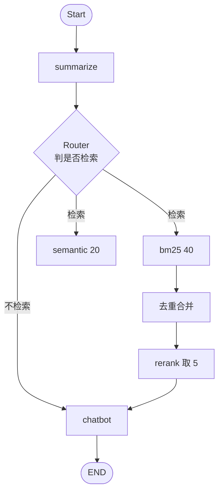
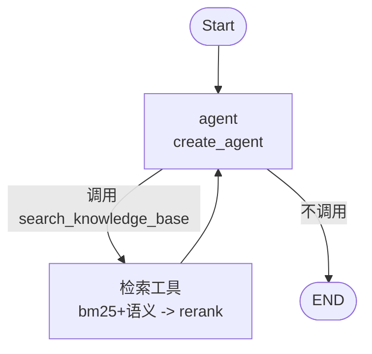

# RAG 两种实现：固定编排 vs Agentic

## 目标

同一套语料、同一个模型，对比两条 RAG 路线：

| | 流程控制 | 构建函数 |
|---|---|---|
| **A** | 固定编排，router 节点决定是否检索 | `router_chat.build_graph(...)` |
| **B** | `create_agent` + 检索工具，模型自主决定 | `rag_agent.build_agent(...)` |

两者的检索链路完全一致：**bm25(40) + 语义(20) 去重 → rerank 取前 5**。
区别只在于「要不要检索」这一决策由谁做、以及流程是否写死。

## 实现差异

### A. 固定编排（`src/helpdesk/router_chat.py`）



- 是否检索由 **router 节点**单独调一次模型判定（`with_structured_output` 返回 `retrieve/chatbot`）。
- 检索固定只做**一次**，字段 `context` 传给 chatbot。

### B. Agentic（`src/helpdesk/rag_agent.py`）



- 只提供一个工具，**何时检索、检索几次、要不要换关键词再查**都由模型决定。
- 提示词承担了原来 router 的职责，是这条路线成败的关键：

```text
【什么时候调用工具 search_knowledge_base】
- 问题涉及 LangChain、LangGraph 的概念、API、类名、参数、配置方式时，先调用它，不要凭记忆作答。
- 一次检索结果不相关或信息不全时，换更准确的关键词再检索，最多 3 次。
- 寒暄、与文档无关的闲聊、或对话历史里已经给出过答案时，不要调用工具，直接回答。

【怎么回答】
- 只使用工具返回的资料和对话历史，不要补充资料之外的内容。
- 资料里没有的信息，直接说明「资料中没有提到」，不要编造。
- 用中文简洁回答，必要时给出代码片段，并标注来源文件名。
```

工具本身：

```python
@tool
def search_knowledge_base(query: str) -> str:
    """在 LangChain / LangGraph 官方文档库中检索，返回最相关的几段原文。"""
    # bm25(40) + 语义(20) 去重 -> rerank 取前 5
```

## 测试

脚本：`tests/compare_rag.py`

```bash
uv run python tests/compare_rag.py
```

**串行**执行：A 跑完 6 轮，B 再跑一遍；各自独立的 `thread_id` 与内存 checkpointer。

### 语料（6 轮）

| 轮次 | 输入 | 期望检索 | 考察点 |
|---|---|---|---|
| 1 | 你好 | 否 | 寒暄不检索 |
| 2 | LangChain 里怎么定义一个工具？ | 是 | 需要查文档 |
| 3 | 向量库检索的基本流程是什么？ | 是 | 需要查文档 |
| 4 | 我刚才问过的技术问题是什么？ | 否 | 历史可回答 |
| 5 | 谢谢 | 否 | 致谢不检索 |
| 6 | LangChain 里怎么定义一个工具？（重复第 2 轮） | 否 | 历史已有答案 |

### 结果

**单次逐轮耗时**（毫秒，修正校验后的一次运行）

| 轮次 | A 固定编排 | B Agentic |
|---|---|---|
| 1 | 305 | 352 |
| 2 | 5489 | 6086 |
| 3 | 6417 | 6021 |
| 4 | 995 | 388 |
| 5 | 165 | 221 |
| 6 | 3228 | 3981 |
| **总计** | **16.60s** | **17.05s** |

**多次运行**（校验口径一致后）

| 运行 | A 总耗时 / 检索判定 | B 总耗时 / 检索判定 |
|---|---|---|
| 1 | 16.60s / 6-6 | 17.05s / 6-6 |
| 2 | 19.63s / 6-6 | 33.21s / 6-6 |

两次运行的答案关键词校验均为 6/6。

## 结论

1. **检索决策能力等价**：两者都做到 6/6，寒暄、致谢、重复提问都能正确跳过检索。
2. **耗时无法区分**：A 两次 16.60s / 19.63s，B 两次 17.05s / 33.21s。
   第 2 次 B 的第 2 轮从 6.1s 跳到 10.9s，是模型服务抖动，不代表实现差异；
   轮次粒度上两者交替领先，没有稳定优势。
3. **A 出现过一次误判**：在某次运行中，第 4 轮「我刚才问过的技术问题是什么？」
   被 router 判成需要检索（5/6）。B 在全部运行中该轮都直接回答，未触发检索。
   原因推测：A 的 router 只看压缩后的历史摘要 + 最近若干条，B 的 agent 直接看完整 messages 自行判断。
   仅一次观察，不足以定论，但方向与上一轮「对话形态更适合判断重复提问」的结论一致。
4. **可控性与成本**：
   - A 多一次 router 模型调用（固定开销），但流程确定、易调试、行为可预测；
   - B 省掉这次调用，但行为依赖提示词，检索次数与时机不固定，排障要看工具调用轨迹。

## 选择建议

- 若问题形态稳定、要求行为可预测（客服常见场景）→ **A 固定编排**。
- 若问题类型差异大、需要多轮改写检索或按需多次查证 → **B Agentic**。
- 两者检索链路相同，可以先上 A 保底，再用 B 处理复杂问题（路由分发）。
