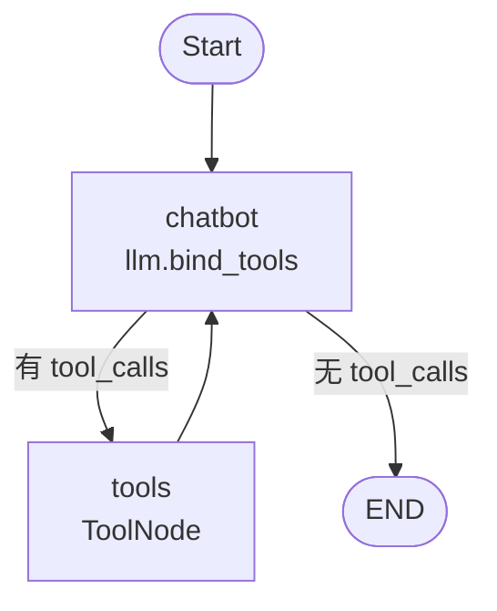

# create_agent 与 LangGraph 编排：两个 chatbot 的对比

## 目标

同一个模型（`init_chat_model`）、同一套语料，对比两个多轮 chatbot：

| | 实现 | 构建函数 |
|---|---|---|
| **A** | 纯 `create_agent` | `agentic_chat.build_agent(model)` |
| **B** | 用 `llm = init_chat_model(...)` 手工搭 LangGraph | `agent_graph.build_graph(llm)` |

两者都用 `TOOLS`（`get_current_time`）、都只用内存历史（`InMemorySaver`），不落盘；
模块只提供构建函数，对话由测试脚本驱动。

## 实现差异

**A. 纯 create_agent**：图、工具循环、系统提示、内存历史全由 `create_agent` 内部管理，一行搞定。

```python
def build_agent(model):
    return create_agent(model, tools=TOOLS, system_prompt=SYSTEM_PROMPT,
                        checkpointer=InMemorySaver())
```

**B. LangGraph 手工编排**：自己定义节点、条件边和工具节点。

```python
def build_graph(llm):
    llm_with_tools = llm.bind_tools(TOOLS)

    def chatbot(state: MessagesState) -> dict:
        messages = [SystemMessage(content=SYSTEM_PROMPT), *state["messages"]]
        return {"messages": [llm_with_tools.invoke(messages)]}

    def should_continue(state: MessagesState):
        return "tools" if state["messages"][-1].tool_calls else END

    builder = StateGraph(MessagesState)
    builder.add_node("chatbot", chatbot)
    builder.add_node("tools", ToolNode(TOOLS))
    builder.add_edge(START, "chatbot")
    builder.add_conditional_edges("chatbot", should_continue, ["tools", END])
    builder.add_edge("tools", "chatbot")
    return builder.compile(checkpointer=InMemorySaver())
```

B 的图结构：



A 内部其实是同一张图，只是由 `create_agent` 自动生成。

## 测试

脚本：`tests/compare_chatbots.py`

```bash
uv run python tests/compare_chatbots.py
```

执行方式：**串行**——A 先跑完全部 8 轮，B 再跑一遍；两者使用独立 `thread_id`，互不影响。
每轮记录：耗时、消息条数、本轮工具调用、校验结果。

### 语料（8 轮）

| 轮次 | 输入 | 考察点 |
|---|---|---|
| 1 | 你好，我叫李浩瑞 | 正常应答 |
| 2 | 我是一名后端工程师，主要写 Python | 记录事实 |
| 3 | 现在几点？ | **工具调用** |
| 4 | 我叫什么名字？ | **历史保持**（第 1 轮） |
| 5 | 我是做什么工作的？ | **历史保持**（第 2 轮） |
| 6 | 我主要用什么编程语言？ | **历史保持**（第 2 轮） |
| 7 | 把刚才说的名字、职业和语言合成一句话 | 多轮归纳 |
| 8 | 现在几点？ | 再次工具调用 |

### 结果

**逐轮耗时**（毫秒）

| 轮次 | A 纯 create_agent | B LangGraph 编排 | 差值 | 消息条数（两者相同） |
|---|---|---|---|---|
| 1 | 261 | 227 | -35 | 2 |
| 2 | 416 | 411 | -5 | 4 |
| 3 | 627 | 624 | -3 | 8 |
| 4 | 127 | 126 | -1 | 10 |
| 5 | 187 | 218 | +32 | 12 |
| 6 | 161 | 156 | -5 | 14 |
| 7 | 308 | 305 | -3 | 16 |
| 8 | 641 | 646 | +5 | 20 |

**汇总**

| 指标 | A | B |
|---|---|---|
| 总耗时 | 2.73s | 2.71s |
| 平均每轮 | 341ms | 339ms |
| 最快 / 最慢 | 127ms / 641ms | 126ms / 646ms |
| 校验通过 | 8/8 | 8/8 |

**关键观察**

- 消息条数逐轮完全相同（2, 4, 8, 10, 12, 14, 16, 20），状态演进一致。
- 第 3、8 轮都真实调用 `get_current_time`，返回时间与系统时间一致。
- 第 4~7 轮都正确回忆第 1、2 轮的姓名/职业/语言。
- 总耗时差 14ms（0.5%），小于同一实现自身的轮次抖动，属噪声。
- 答案措辞并非逐字相同（完全一致 3/8），这是采样随机性：两者校验均 8/8，语义一致。

## 结论

1. **功能完全等价**：消息条数、工具调用、事实回忆、校验结果逐轮一致。
2. **耗时无差异**：2.73s vs 2.71s，波动在噪声范围内。
3. **主要差别是代码量与可控性**：
   - A 一行 `create_agent`，但想改内部行为（加中间件、改循环）得看它的约定；
   - B 约 20 行显式搭图，每个节点、边、提示词位置都自己掌控，插入检索/改写/审核节点直接加即可。
4. **选择建议**：只做纯对话选 A；需要精确控制流程或后续要加环节选 B。
