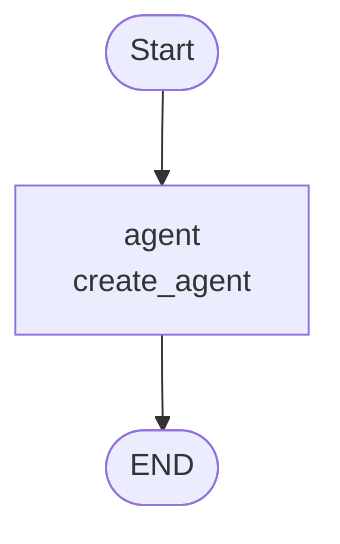

# create_agent 与 graph 编排

## 目标

用 `create_agent` 产出的 agent，套一层 `StateGraph` 做编排，实现多轮对话；
历史只存进程内（`InMemorySaver`），退出即丢，不写本地文件。

## 实现

文件：`src/helpdesk/agent_graph.py`

```python
def build_graph(model):
    agent = create_agent(model, tools=TOOLS, system_prompt=SYSTEM_PROMPT)
    builder = StateGraph(MessagesState)
    builder.add_node("agent", agent)     # 编译好的 agent 直接当节点
    builder.add_edge(START, "agent")
    builder.add_edge("agent", END)
    return builder.compile(checkpointer=InMemorySaver())
```

要点：

1. **agent 当节点**：`create_agent` 返回的是已编译的图，可直接 `add_node` 嵌套进外层图。
2. **状态兼容**：内层 agent 用 `AgentState`，外层用 `MessagesState`，两者都以 `messages` 为核心，嵌套无需转换。
3. **内存历史**：`InMemorySaver` 存 RAM，进程结束即丢；`thread_id` 固定为 `default`，进程内视为同一会话。
4. **工具**：复用 `helpdesk.TOOLS`（`get_current_time`），由 agent 自行决定是否调用。

图结构：



`agent` 节点内部仍是标准的 ReAct 循环（模型 → 工具 → 模型），由 `create_agent` 负责。

## 运行

```bash
uv run python src/helpdesk/agent_graph.py
```

## 测试

同一套语料，依次输入三句，验证「历史保持」与「工具调用」。

```text
你好，我叫李浩瑞
我叫什么名字？
现在几点？
```

### 结果

| 轮次 | 输入 | 输出 | 验证点 |
|---|---|---|---|
| 1 | 你好，我叫李浩瑞 | 你好，李浩瑞！有什么可以帮你的吗？ | 正常应答 |
| 2 | 我叫什么名字？ | 你叫李浩瑞。 | **历史保持** |
| 3 | 现在几点？ | 现在是2026年10月18日15时53分02秒。 | **工具调用** |

第 3 轮的消息轨迹：

```text
序列: human, ai, human, ai, human, ai, tool, ai
工具调用: [('get_current_time', {})]
工具返回: 2026-10-18 15:53:02
```

对照本机 `date`：`2026-10-18 15:53:00`，工具返回值与系统时间一致，确认是真实调用而非模型臆测。

## 结论

- `create_agent` 与 `StateGraph` 可以无损组合：前者管 ReAct 循环，后者管流程编排。
- 只加 `InMemorySaver` 就能满足「多轮但不落盘」，无需 `SqliteSaver`。
- 当前这个图只有单个 agent 节点，等同于纯 `create_agent`（见 `agentic_chat.py`）；
  套图的意义在于**预留编排能力**：后续要在 agent 前后插入节点（检索、改写、审核）时，直接加节点和边即可。
