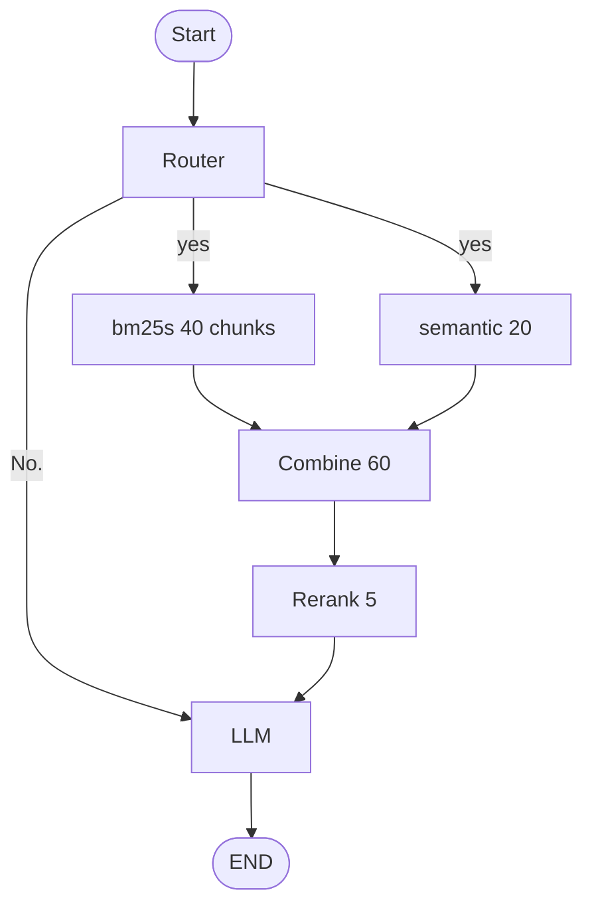

## graph图



## Router prompts

```text
当历史对话可以回答问题返回"yes"
当历史对话无法回答问题返回"no"
```

## LLM prompts

```text
根据"content"及其历史对话回答问题, 当"content"内容及其历史对话无法恢复"question"时, 则明确表示知识库内容未涵盖"question"的答案.

[question]:
{question}

[content]:
{content}
```

